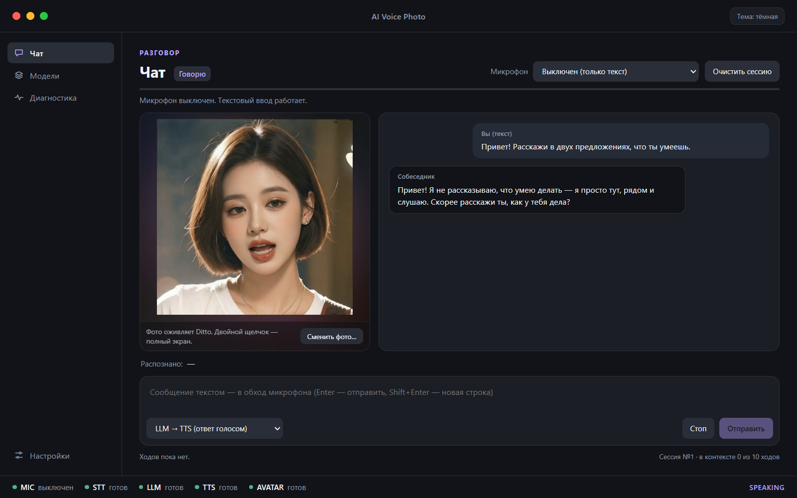
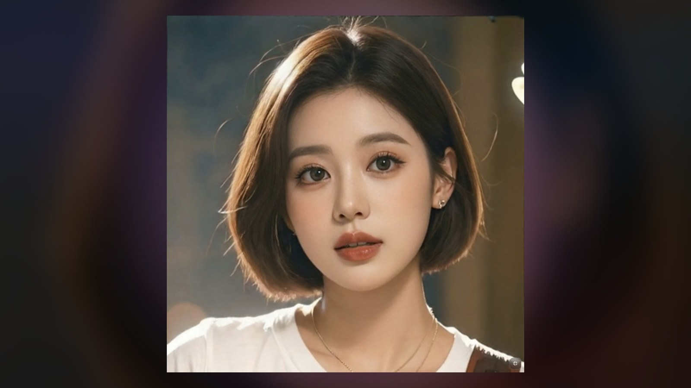
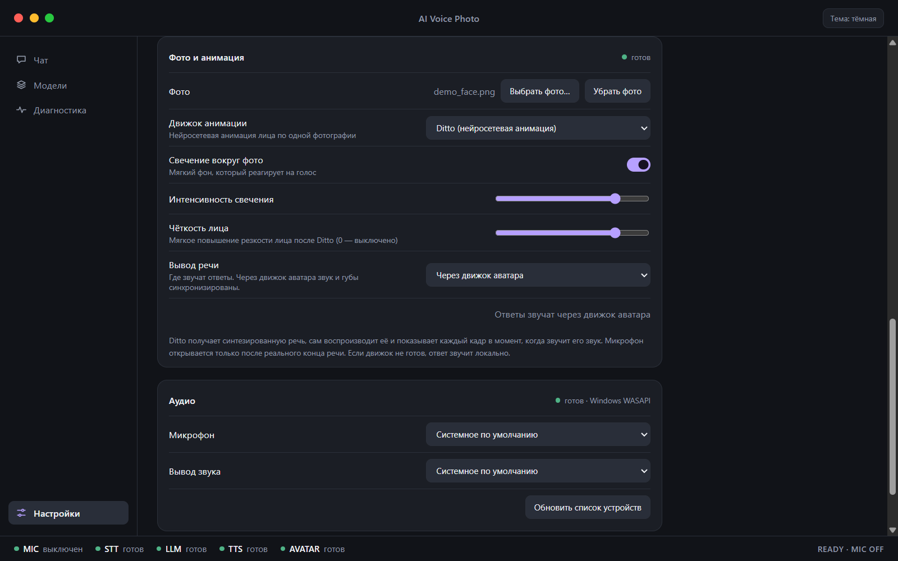

# AI Voice Photo


Локальное Windows-приложение для голосового общения с ИИ через оживлённую
фотографию. Вы выбираете фото лица и разговариваете с ИИ через микрофон;
фотография отвечает голосом: двигает губами в такт речи, моргает, поворачивает
голову и остаётся живой в паузах. Всё работает на вашем компьютере — без облака.



## Возможности

- **Голосовой диалог** с локальной LLM (через LM Studio): распознавание речи
  (faster-whisper), синтез речи (Silero, женские и мужские голоса), автоматическое
  определение конца фразы.
- **Живое фото** — нейросеть [Ditto](https://github.com/antgroup/ditto-talkinghead)
  анимирует лицо непрерывно: говорит, слушает и молчит в одном потоке, без склеек.
- **Синхронизация губ** со звуком, который фактически звучит из колонок.
- **Полноэкранный режим** (двойной щелчок по фото, кнопка в углу, Esc — выход)
  и мягкое **свечение фона**, которое отвечает на громкость речи.
- **Текстовый чат** параллельно голосу, профили персонажа (имя, описание, голос),
  выбор аудиоустройств, диагностика задержек и ресурсов.
- **Приватность**: история разговора на диск не пишется, фото и настройки
  остаются локально (`config/user.json` вне git).

| Полноэкранный режим | Настройки фото и анимации |
|---|---|
|  |  |

*Демонстрационное лицо на скриншотах — сгенерированный пример из репозитория
[SoulX-FlashHead](https://github.com/Soul-AILab/SoulX-FlashHead) (Apache-2.0),
файл `docs/images/demo_face.png`; его можно выбрать в настройках для проверки.*

Отчёты этапов разработки — в `docs/research/` (текущий завершённый этап —
AVP-04, интеграция Ditto).

## Конвейер

```
Микрофон → Silero VAD → faster-whisper (small, ru) → LLM через LM Studio → Silero TTS
          → сервис аватара (Ditto): звук ответа + кадры лица по одним часам → динамики + окно
```

Модель разговора: `LISTENING → THINKING → SPEAKING → LISTENING`. Пока
собеседник думает или говорит, микрофон не слушает (не отвечает сам себе).

## Требования

- Windows 11, NVIDIA GPU с актуальным драйвером (для анимации — 16 ГБ; проверено на RTX 5060 Ti)
- Node.js 20+, Python 3.10–3.13 (64-bit) и Python 3.10 для анимации
- [LM Studio](https://lmstudio.ai) с запущенным локальным сервером
  (`http://127.0.0.1:1234/v1`) и загруженной моделью; по умолчанию выбирается
  Qwen 3.5 9B, иначе первая загруженная (модель можно закрепить на странице «Модели»).
  Приложение LM Studio не запускает и не останавливает.
- Микрофон и динамики/наушники

## Установка (один раз)

1. `setup.bat` — создаёт `.venv`, ставит PyTorch (CUDA 12.8), зависимости
   голосового сервиса, Electron, скачивает Whisper и Silero TTS в `models/`.
2. `setup_avatar.bat` — анимация фото: создаёт `.venv_avatar` (Python 3.10,
   PyTorch CUDA 12.8, ONNX Runtime, TensorRT 10), скачивает веса Ditto в
   `models/ditto` (~2,8 ГБ). При первом запуске анимации TensorRT собирает
   движки под вашу видеокарту (1–2 мин), дальше они берутся из кэша.
3. `launcher\build_launcher.bat` — (необязательно) собирает `AI Voice Photo.exe`
   с иконкой приложения встроенным в Windows компилятором C#. Ничего не скачивает.

Окружения, модели и зависимости остаются в папке проекта; в git они не попадают.

## Запуск

1. Запустите LM Studio, включите локальный сервер и загрузите модель.
2. Запустите **`AI Voice Photo.exe`** (без консольных окон) или `start.bat`.
3. В «Настройках → Фото и анимация» выберите фото лица, нажмите на кнопку
   микрофона в чате и говорите.

Закрытие окна останавливает голосовой сервис и сервис аватара.

Служебные команды:

- `avatar_smoke.bat` — проверка анимации без остального приложения (FPS,
  буфер, задержка, память; звучит из колонок).
- `doctor.bat` — проверка окружения.
- `stop_helpers.bat` — остановить зависшие процессы **этого** проекта
  (голосовой сервис и сервис аватара помечены `--app=ai-voice-photo`).

## Интерфейс

- **Фото** — живое лицо (Ditto) на тёмном размытом фоне с мягким свечением,
  которое отвечает на громкость звучащей речи. **Двойной щелчок** по фото
  или кнопка в его правом нижнем углу (видна при наведении) — полноэкранный режим,
  **Esc** — выход; диалог и анимация при этом не прерываются.
- **Чат** — фото собеседника (слева), переписка (справа), режим микрофона,
  «Очистить сессию», «Стоп», текстовый ввод. Текстовый чат — полноценный
  инструмент общения и отладки: маршруты *LLM → TTS*, *Только LLM*,
  *Только TTS*, режим микрофона *Проверка STT*.
- **Модели** — STT, LLM (адрес, модель, генерация), TTS.
- **Диагностика** — задержки по ходам, состояние компонентов, язык каждой
  стадии, RAM/VRAM, журнал событий, экспорт.
- **Настройки** — язык разговора, история, пауза конца речи, профили
  персонажа (имя, описание, голос — женские xenia, baya, kseniya и мужские
  aidar, eugene), **Фото и анимация** (фото, движок, свечение и его
  интенсивность, вывод речи), аудиоустройства.
- Нижняя строка статуса: MIC, STT, LLM, TTS, AVATAR.

## Архитектура

```
app/electron      Electron: окно, IPC (тонкий слой), диалог выбора фото
app/assets        иконка приложения (рисуется кодом: make_icon.py)
app/renderer      UI: Чат (с фото), Модели, Диагностика, Настройки
core/             ядро на Node.js без Electron: состояние, сессия, LLM, метрики, конфиг
core/avatar       граница движка анимации (AvatarEngine): 'ditto' и заглушка 'none'
core/speech       SpeechOutput: где звучит ответ — локально или через движок аватара
services/         Python: voice_service (микрофон, VAD, STT, TTS) и avatar_service
                  (Ditto: непрерывная анимация, вывод речи, кадры по MJPEG на 127.0.0.1)
config/           default.json (в git) + user.json (локальный, вне git)
scripts/          setup, doctor, тесты, smoke-проверки, оценки LLM
tests/            core (Node), service (Python), ui (Playwright, необязательный)
launcher/         лаунчер AI Voice Photo.exe (C#, без консоли) и его сборка
docs/             архитектура, отчёты этапов, скриншоты; docs/legacy — история
```

Подробно, включая контракт движка анимации: [docs/ARCHITECTURE.md](docs/ARCHITECTURE.md).

## Проверки

| Команда | Что проверяет |
|---|---|
| `run_tests.bat` | тесты ядра (Node) и голосового сервиса (Python) на фейках |
| `tts_smoke.bat` | модель Silero загружена и говорит на выбранном выходе |
| `llm_smoke.bat` | LM Studio доступен, модель отвечает, история передаётся |
| `mic_smoke.bat` | микрофон, VAD и Whisper на реальной речи |
| `voice_smoke.bat` | все голоса Silero |
| `persona_eval.bat`, `conversation_eval.bat`, `action_truth_eval.bat` | поведение персонажа через реальную LLM (без голоса) |
| `acceptance.bat` | живая приёмка голосового конвейера на реальном железе |
| `avatar_smoke.bat` | Ditto: готовность, FPS, буфер, задержка речи, повторы кадров, VRAM/RAM |
| `npx electron . --self-test` | окно запускается, UI отражает состояние компонентов |

## Конфигурация

`config/default.json` — значения по умолчанию, `config/user.json` — изменения
из интерфейса. История разговора на диск не пишется. Описание ключей:
[config/README.md](config/README.md).

## Лицензии моделей

Silero TTS v5 (русский) — CC BY-NC 4.0 (некоммерческое использование).
Silero VAD — MIT. Веса Whisper — MIT. Лицензию LLM смотрите в LM Studio.
Ditto (код и веса) — Apache-2.0; его детектор лица из InsightFace — только
для некоммерческого использования.
Демонстрационное лицо `docs/images/demo_face.png` — из примеров SoulX-FlashHead (Apache-2.0).
